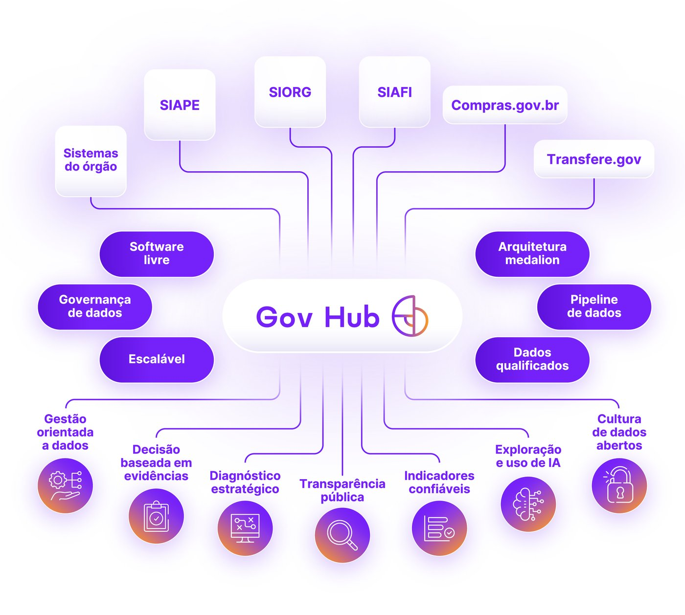
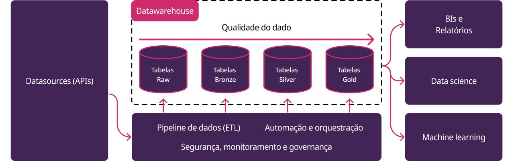

# Gov Hub BR - Transformando Dados em Valor para Gestão Pública

O Gov Hub BR é uma iniciativa para enfrentar os desafios da fragmentação, redundância e inconsistências nos sistemas estruturantes do governo federal. O projeto busca transformar dados públicos em ativos estratégicos, promovendo eficiência administrativa, transparência e melhor tomada de decisão. A partir da integração de dados, gestores públicos terão acesso a informações qualificadas para subsidiar decisões mais assertivas, reduzir custos operacionais e otimizar processos internos. 

Potencializamos informações de sistemas como TransfereGov, Siafi, ComprasGov e outros para gerar diagnósticos estratégicos, indicadores confiáveis e decisões baseadas em evidências.



- Transparência pública e cultura de dados abertos
- Indicadores confiáveis para acompanhamento e monitoramento
- Decisões baseadas em evidências e diagnósticos estratégicos
- Exploração de inteligência artificial para gerar insights
- Gestão orientada a dados em todos os níveis

## Fluxo/Arquitetura de Dados

A arquitetura do Gov Hub BR é baseada na Arquitetura Medallion,  em um fluxo de dados que permite a coleta, transformação e visualização de dados.



## Apoio

Esse trabalho é mantido pelo [Lab Livre](https://www.instagram.com/lab.livre/).

## Contato

Para dúvidas, sugestões ou para contribuir com o projeto, entre em contato conosco: [lablivreunb@gmail.com](mailto:lablivreunb@gmail.com)

# Infra — Gov-Hub MIR (GitOps)

Infraestrutura de dados do **MIR** (Ministério da Igualdade Racial) gerenciada via **Argo CD (GitOps)**.  
Este repositório é derivado do [`continuous-deployment`](https://github.com/GovHub-br/continuous-deployment) do Gov-Hub e sobe o ambiente da aplicação [`data-application-mir`](https://github.com/GovHub-br/data-application-mir).  
Este monorepo contém os manifests/helm charts e os **overlays por ambiente** para:

- **Argo CD** (controle GitOps)
- **App-of-Apps** (gera os Applications filhos)
- **Airflow** (ETL/ELT)
- **MinIO** (objeto storage)
- **Postgres** (opcional, desabilitado em prod/preprod: bancos do MIR ficam fora do cluster)

> **Importante:** não publicamos **URLs/portas** no README raiz. Endpoints e credenciais são tratados por ambiente e documentados internamente, quando necessário, nos respectivos READMEs.

---

## Sumário

- [Infra — Gov-Hub MIR (GitOps)](#infra--gov-hub-mir-gitops)
  - [Configuração do ambiente do MIR](#configuração-do-ambiente-do-mir)
  - [Sumário](#sumário)
  - [Estrutura do repositório](#estrutura-do-repositório)
  - [Conceitos](#conceitos)
    - [Overlays por ambiente](#overlays-por-ambiente)
    - [App-of-apps](#app-of-apps)
    - [Sync waves](#sync-waves)
  - [Pré-requisitos](#pré-requisitos)
  - [Bootstrap / Deploy](#bootstrap--deploy)
  - [Segurança: secrets \& acessos](#segurança-secrets--acessos)
  - [Padrões de contribuição](#padrões-de-contribuição)
  - [Referências por componente](#referências-por-componente)

---

## Configuração do ambiente do MIR

| Item | Configuração |
|---|---|
| Repositório das DAGs (git-sync) | `data-application-mir` |
| Imagem do Airflow | `ghcr.io/govhub-br/airflow-mir:<sha>` (publicada pela CI do `data-application-mir`) |
| Python da imagem | 3.11 (`PYTHONPATH` ajustado) |
| Variáveis do Data Warehouse | `DB_DW_*_MIR` (secret `db-dw-mir`), lidas pelo `profiles.yml` do dbt |
| Conexões do Airflow | `postgres_default` e `postgres_mir` via secret `airflow-mir-connections` |
| Homologação (`values.preprod.yaml`) | Aponta para `airflow/homolog` |

> **Pendências antes do primeiro deploy** (marcadas com `TODO` nos arquivos):
> - Domínios do Argo CD (`argocd/values.*.yaml`) e do Airflow (`airflow/*/kustomization.yaml`) estão com placeholders `*.mir.example.com`.
> - Este repositório está em `https://github.com/GovHub-br/continuous-deployment-mir.git` (público), referenciado em `app-of-apps/values.yaml` e `argocd/`. Por ser público, o Argo CD não precisa da Secret `repo-access`; ela só é necessária se o repositório passar a ser privado (ver `argocd/README.md`).
> - A tag da imagem do Airflow (`airflow/base/values.yaml`) deve ser atualizada a cada release do `data-application-mir`.
> - Se o MIR for instalado num cluster **compartilhado** com outros projetos, confira se os namespaces e as NodePorts não conflitam com os já existentes.

---

## Estrutura do repositório

```text
.
├── airflow/        # README e manifests do Airflow (overlays prod, homolog e teste)
├── app-of-apps/    # Chart que gera os Applications filhos
├── argocd/         # Instalação do Argo CD + entrypoints (prod, preprod e teste)
├── assets/         # Imagens usadas neste README
├── minio/          # README e manifests do MinIO (+ overlay prod)
├── postgres/       # manifests do Postgres (desabilitado em prod/preprod)
├── DEPLOY.md       # Como subir o ambiente
└── README.md       # (este arquivo)
```

Cada pasta possui um **README próprio** com detalhes de setup, pré-requisitos específicos e exemplos.

---

## Conceitos

### Overlays por ambiente

* Arquivos `values.*.yaml` **sobrescrevem apenas** o que muda por ambiente (ex.: `values.prod.yaml`, `values.preprod.yaml`, `values.teste.yaml`).
* O ambiente `teste` foi criado para validar o repositório num cluster isolado: é igual ao `prod`, mas sem Ingress/HTTPS e com o Postgres dentro do cluster.
* O merge é **por chave** (deep-merge). O que não está no overlay é **herdado** do base.

### App-of-apps

* Um `Application` **raiz** gera/aplica os `Applications` **filhos** (Airflow, MinIO, Postgres, etc.).
* Cada filho pode usar Helm, Kustomize ou plugin (`kustomized-helm`).
* A ordem de bootstrap é definida por **sync waves**.

### Sync waves

* Usamos a anotação `argocd.argoproj.io/sync-wave: "<N>"` para ordenar a aplicação.
* Regra geral:

  * **Infra base/dependências**: waves negativas (ex.: DB/obj storage)
  * **Orquestrador**: `0` (ex.: Airflow)
  * **Visualização/serviços finais**: `1+` (nenhum no MIR)

---

## Pré-requisitos

* Acesso ao **cluster Kubernetes** (kubeconfig).
* **kubectl**, **helm** e (opcional) **argocd CLI** instalados.
* Secrets exigidos por cada app criados **antes** do deploy (ver README de cada componente).

---

## Bootstrap / Deploy

> **Como subir o ambiente:** [`DEPLOY.md`](./DEPLOY.md) descreve os pré-requisitos, onde ajustar as URLs, os namespaces e Secrets necessários e a ordem para subir o ambiente num cluster que já está no ar.

O fluxo padrão é **declarativo** via Argo CD:

1. **Argo CD**: instale/sincronize conforme `argocd/README.md` (usa `values.yaml` + overlay do ambiente).
2. **App-of-apps**: o `application.<env>.yaml` cria o Application raiz; ao sincronizar, ele gera/aplica os filhos conforme `app-of-apps/values.<env>.yaml`.
3. **Waves** garantem a ordem (ex.: MinIO → Airflow).

> Para **testes** pontuais, cada componente expõe um comando de **renderização/aplicação manual** (`kubectl kustomize ... | kubectl apply -f - -n <ns>`). Em produção, evite aplicar manualmente para não criar **drift**.

---

## Segurança: secrets & acessos

* **Nunca** commitar credenciais no repositório.
* Criar secrets via `kubectl -n <ns> apply -f - <<'EOF' ... EOF` ou usar gerenciadores (Sealed/External Secrets, se adotados).
* As secrets exigidas pelo Airflow do MIR (DW, conexões, Git, SMTP, MinIO) estão listadas no README do **Airflow**.
* Acesso a painéis/DBs é tratado **por ambiente**; procure a equipe de infra para endpoints e credenciais.

---

## Padrões de contribuição

* **Branches**: prefira prefixos `feat/`, `fix/`, `refactor/`, `docs/`.
* **Commits**: **Conventional Commits** (ex.: `feat(argocd): ...`, `docs(airflow): ...`).
* **MR/PR**: descreva o *porquê* e liste mudanças relevantes (paths/values alterados).
* **Rebase** da branch com `main` antes de abrir o MR:

  ```bash
  git fetch origin
  git rebase origin/main
  git push --force-with-lease
  ```

---

## Referências por componente

* **Como subir o ambiente**: [`DEPLOY.md`](./DEPLOY.md)
* **Argo CD**: [`argocd/README.md`](./argocd/README.md)
* **App-of-apps**: [`app-of-apps/README.md`](./app-of-apps/README.md)
* **Airflow**: [`airflow/README.md`](./airflow/README.md)
* **MinIO**: [`minio/README.md`](./minio/README.md)
